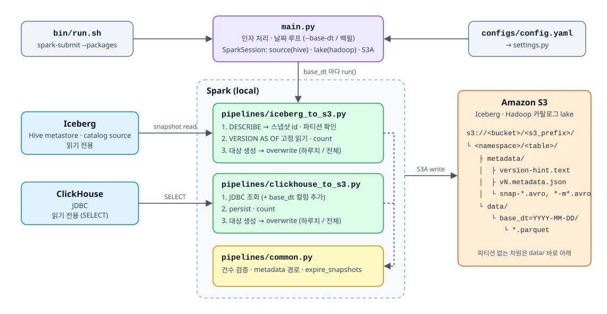
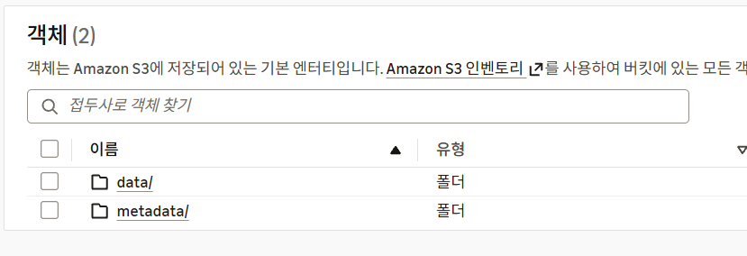
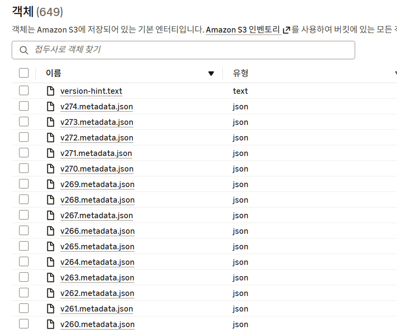
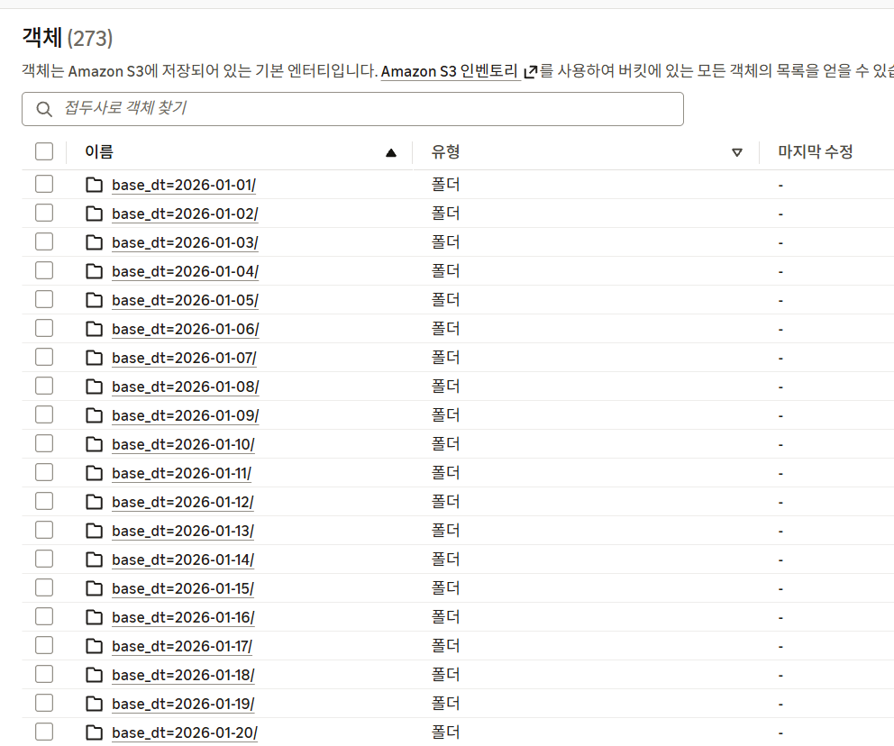

# spark-lakehouse-s3-sync

Iceberg(Hive metastore) 와 ClickHouse 테이블을 Spark 로 읽어
**S3 의 Iceberg 테이블(Hadoop 카탈로그)** 로 매일 동기화하는 예제입니다.

- 원본은 읽기만 합니다 (Iceberg: 스냅샷 고정 읽기 / ClickHouse: JDBC SELECT)
- 대상은 S3 에 data·metadata 를 새로 씁니다 → metadata 안의 경로가 처음부터 `s3://` 를 가리킵니다
- 팩트는 `base_dt` 하루치 파티션만, 차원(마스터성)은 테이블 전체를 덮어씁니다



## 구조

```text
spark-lakehouse-s3-sync/
  bin/run.sh                       # spark-submit 실행 (config 의 spark 섹션 사용)
  configs/config.yaml              # 모든 설정 (예제 값)
  requirements.txt
  src/spark_lakehouse_s3_sync/
    main.py                        # 인자 처리, SparkSession(카탈로그·S3A) 생성, 날짜 루프
    settings.py                    # config.yaml → 설정 객체
    images/                        # 실제 S3 적재 화면 예시
    pipelines/
      common.py                    # 대상 공통: 존재 확인, 속성, 건수 검증, 스냅샷 만료
      iceberg_to_s3.py             # Iceberg → S3
      clickhouse_to_s3.py          # ClickHouse → S3
```

## 요구 사항

- Java 11+, Spark 3.4.x (`SPARK_HOME` 또는 PATH 의 `spark-submit`)
- Python 3.8+, `pip install -r requirements.txt`
- 실행 서버에서 Maven Central 접속 (`--packages` 로 jar 를 받음)
- S3 버킷 쓰기 권한이 있는 AWS access key

### 필요한 jar

`configs/config.yaml` 의 `spark.packages` 에 Maven 좌표로 적혀 있고, `bin/run.sh` 가 `spark-submit --packages` 로 넘깁니다.
첫 실행 때 Maven Central 에서 의존 jar 까지 받아 `~/.ivy2/jars/` 에 캐시합니다.

| Maven 좌표 | jar 파일 | 용도 |
|---|---|---|
| `org.apache.iceberg:iceberg-spark-runtime-3.4_2.12:1.9.2` | `iceberg-spark-runtime-3.4_2.12-1.9.2.jar` | Iceberg 카탈로그, 읽기·쓰기 (Spark 3.4 / Scala 2.12) |
| `org.apache.hadoop:hadoop-aws:3.3.4` | `hadoop-aws-3.3.4.jar` | S3A 파일시스템 (Spark 에 포함된 Hadoop 버전과 맞춤) |
| `com.amazonaws:aws-java-sdk-bundle:1.12.262` | `aws-java-sdk-bundle-1.12.262.jar` | hadoop-aws 3.3.4 가 쓰는 AWS SDK |
| `com.clickhouse:clickhouse-jdbc:0.9.9` | `clickhouse-jdbc-0.9.9-all.jar` (의존성 포함판) | ClickHouse JDBC 드라이버 |

### 서버(Linux)에 jar 직접 받기

```bash
# Maven Central 에서 받기
mkdir -p jars && cd jars
curl -fLO https://repo1.maven.org/maven2/org/apache/iceberg/iceberg-spark-runtime-3.4_2.12/1.9.2/iceberg-spark-runtime-3.4_2.12-1.9.2.jar
curl -fLO https://repo1.maven.org/maven2/org/apache/hadoop/hadoop-aws/3.3.4/hadoop-aws-3.3.4.jar
curl -fLO https://repo1.maven.org/maven2/com/amazonaws/aws-java-sdk-bundle/1.12.262/aws-java-sdk-bundle-1.12.262.jar
curl -fLO https://repo1.maven.org/maven2/com/clickhouse/clickhouse-jdbc/0.9.9/clickhouse-jdbc-0.9.9-all.jar
ls -lh *.jar

# Spark 기본 클래스패스에 두기
cp *.jar "$SPARK_HOME/jars/"
```

> 외부 접속이 막힌 서버에서는 jar 를 위처럼 넣은 뒤 `bin/run.sh` 의 `--packages "$PACKAGES"` 줄을 지우고 실행합니다.

## 설정

`configs/config.yaml` 의 예제 값을 실제 값으로 바꿉니다.

| 섹션 | 항목 | 설명 |
|---|---|---|
| aws | access_key_id, secret_access_key, region_name, s3_bucket | S3 접속과 대상 버킷 |
| spark | master, driver_memory, packages | spark-submit 옵션 |
| iceberg | catalog, metastore_uri | 원본 Iceberg 카탈로그 (Hive metastore) |
| iceberg | target_catalog, s3_prefix, s3_endpoint | 대상 S3 Hadoop 카탈로그, warehouse = `s3://<s3_bucket>/<s3_prefix>` |
| iceberg / clickhouse | tables | `ns.table` (전체 덮어쓰기) 또는 `{name: ns.table, date_column: col}` (하루치) |

- Iceberg 의 `date_column` 은 원본의 **identity 파티션 컬럼**이어야 합니다.
- ClickHouse 의 `date_column` 은 Date/DateTime 타입이어야 하며, 대상에는 `base_dt` 파티션 컬럼이 추가됩니다.

> ⚠️ `configs/config.yaml` 은 git 에 커밋됩니다. 실제 키를 넣은 상태로 commit/push 하지 마세요.

## 실행

```bash
# 1) dry-run: 원본 조회·건수 확인만 (S3 에 쓰지 않음)
bin/run.sh --base-dt 2026-11-20

# 2) 일배치: 차원 전체 + 팩트 하루치
bin/run.sh --base-dt 2026-11-20 --dry-run false 2>&1 | tee run.log

# 3) 백필: 팩트만 날짜별 (차원은 건너뜀)
bin/run.sh --start-dt 2026-11-01 --end-dt 2026-11-20 --dry-run false

# 4) 일부 테이블만
bin/run.sh --base-dt 2026-11-20 --tables shop.fct_order --dry-run false

# 결과 확인
grep -E "copied|dry_run|failed" run.log
```

테이블마다 아래 한 줄이 남습니다.

```text
[shop.fct_order] copied rows=12345 scope=base_dt = DATE '2026-11-20'
  metadata=s3://example-lakehouse-bucket/warehouse/shop/fct_order/metadata/v3.metadata.json expired=...
```

## S3 에 쌓이는 구조

warehouse = `s3://example-lakehouse-bucket/warehouse` 기준입니다.

```text
s3://example-lakehouse-bucket/warehouse/
├── shop/
│   ├── dim_product/                       # 차원: 파티션 없음
│   │   ├── metadata/
│   │   │   ├── version-hint.text
│   │   │   ├── v1.metadata.json
│   │   │   ├── v2.metadata.json
│   │   │   ├── snap-<snapshot-id>-1-<uuid>.avro
│   │   │   └── <uuid>-m0.avro
│   │   └── data/
│   │       └── 00000-<task>-<uuid>-00001.parquet
│   └── fct_order/                         # 팩트: 원본 파티션 그대로
│       ├── metadata/ ...
│       └── data/
│           ├── base_dt=2026-11-19/*.parquet
│           └── base_dt=2026-11-20/*.parquet
└── analytics/                             # ClickHouse 원천 (<db>.<table> 그대로)
    ├── page_view_log/data/base_dt=2026-11-20/*.parquet
    └── product_stats/data/*.parquet
```

### 실제 S3 저장 예시

팩트 테이블 1개를 일배치·백필로 적재한 뒤 S3 콘솔에서 본 화면입니다.

**① 테이블 경로: `data/` 와 `metadata/` 두 폴더**



**② `metadata/`: `version-hint.text` 와 커밋마다 하나씩 늘어나는 `vN.metadata.json`**

`version-hint.text` 에 현재 번호(여기서는 274)가 들어 있고, Hadoop 카탈로그는 이 번호로 `v274.metadata.json` 을 읽습니다.
객체 수(649)에는 `vN.metadata.json` 외에 매니페스트 리스트(`snap-*.avro`)·매니페스트(`*-m*.avro`)가 함께 들어 있습니다.



**③ `data/`: `base_dt` 파티션별 폴더 (하루 1개)**

`--base-dt` 일배치나 `--start-dt/--end-dt` 백필이 날짜마다 `base_dt=YYYY-MM-DD/` 폴더를 하나씩 채웁니다.
같은 날짜를 다시 돌리면 그 폴더 안에 새 parquet 가 생기고, 이전 파일은 스냅샷 만료 때 지워집니다.



### 파일별 역할

| 위치 | 파일 | 역할 | 언제 생기나 |
|---|---|---|---|
| `metadata/` | `version-hint.text` | 현재 버전 번호(N) 한 줄. Hadoop 카탈로그는 이 파일로 최신 `vN.metadata.json` 을 찾음 | 커밋마다 갱신 |
| `metadata/` | `vN.metadata.json` | 테이블 정의 전체: 스키마, 파티션 스펙, 속성, 스냅샷 목록, 현재 스냅샷 | 커밋마다 1개 (테이블 생성·덮어쓰기·속성 변경·스냅샷 만료) |
| `metadata/` | `snap-<id>-<n>-<uuid>.avro` | 매니페스트 리스트: 스냅샷 1개가 가리키는 매니페스트 목록 | 데이터 커밋(스냅샷)마다 1개 |
| `metadata/` | `<uuid>-m<n>.avro` | 매니페스트: data 파일 경로·파티션 값·건수·컬럼 통계 | 데이터 커밋마다 1개 이상 |
| `data/` | `*.parquet` | 실제 데이터 | 데이터 커밋마다 |

읽는 순서: `version-hint.text` → `vN.metadata.json` → 매니페스트 리스트 → 매니페스트 → parquet

### 하루 배치가 바꾸는 것 (팩트 테이블)

| 단계 | metadata | data |
|---|---|---|
| 첫 실행: 테이블 생성 | `v1.metadata.json` (빈 테이블) | 없음 |
| `--base-dt 2026-11-20` 덮어쓰기 | `vN+1.metadata.json`, 매니페스트 리스트·매니페스트 추가 | `base_dt=2026-11-20/` 새 parquet. 같은 날짜의 이전 파일은 현재 스냅샷에서 빠지지만 S3 에는 남음 |
| 같은 날짜 재실행 | 위와 동일 (새 스냅샷) | 새 parquet 로 교체, 이전 파일은 S3 에 남음 |
| 스냅샷 만료 (매 실행 끝) | 30일 지난 스냅샷 제거 → 새 `vN.metadata.json` | 만료 스냅샷에서만 쓰던 parquet·avro 를 S3 에서 삭제 |

### 정리 규칙

| 대상 | 규칙 | 설정 위치 |
|---|---|---|
| 스냅샷 | 30일 지난 스냅샷 만료, 최소 1개 유지 | `common.py` `SNAPSHOT_RETENTION_DAYS` |
| `vN.metadata.json` | 최근 100개만 유지, 나머지는 커밋 때 자동 삭제 | 테이블 속성 `write.metadata.previous-versions-max`, `write.metadata.delete-after-commit.enabled` |
| 덮어써진 parquet | 스냅샷 만료 때 함께 삭제 | `expire_snapshots` |

### 외부 엔진에서 읽기

로그의 `metadata=s3://.../vN.metadata.json` 경로로 Iceberg 테이블을 등록하거나 갱신합니다.

## 주의

- **원본 보호**: `target_catalog` 가 원본 `catalog` 와 같으면 실행을 중단합니다.
- **동시 실행 금지**: Hadoop 카탈로그는 동시 커밋에 안전하지 않아 `bin/run.sh` 가 `flock` 으로 막습니다.
- **ClickHouse 시간대**: 하루 범위는 ClickHouse 서버 시간대 기준입니다. `date_column` 이 NULL 인 행은 어느 날짜에도 들어가지 않습니다.

```bash
git grep -nE "AKIA[0-9A-Z]{16}|secret_access_key: [^Y]|password: [^e]"
```
